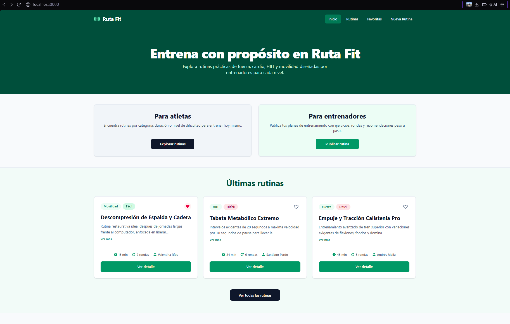
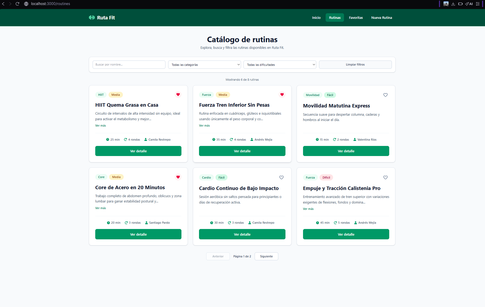
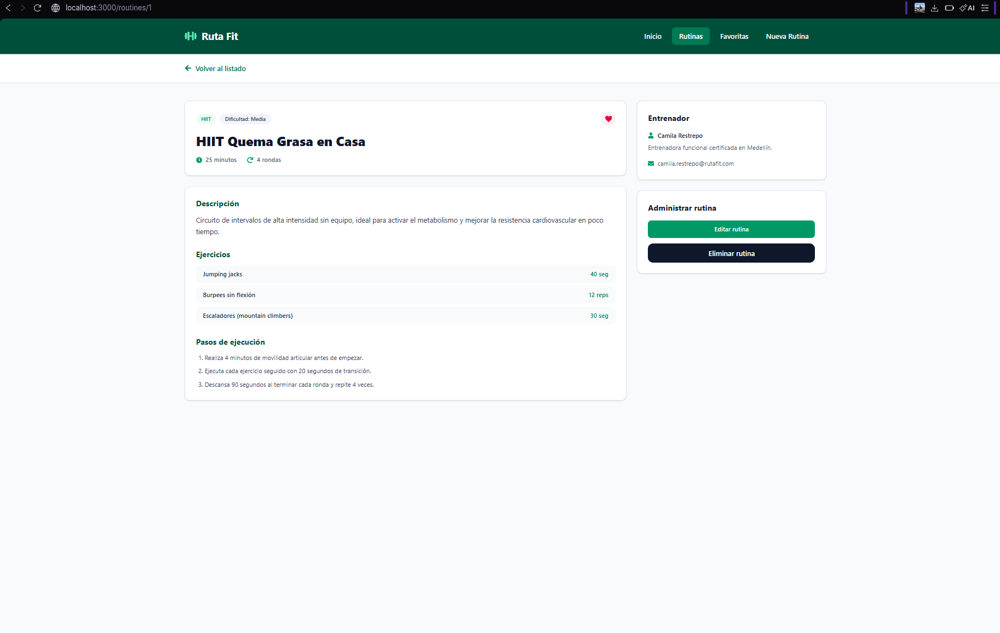
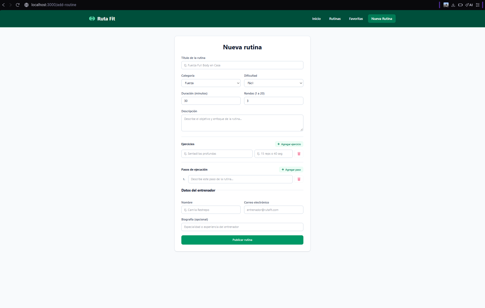

# Ruta Fit

Aplicación web de catálogo y gestión de rutinas de ejercicio construida desde cero con **React 19**, **Vite**, **Tailwind CSS 4**, **React Router 7** y **json-server**, desarrollada como adaptación de la actividad práctica **React 19 CookBook**.

**Ruta Fit** permite a cualquier visitante explorar, buscar, filtrar y paginar rutinas de entrenamiento, y a cualquier entrenador o usuario publicar, editar, eliminar y marcar rutinas como favoritas, incluyendo categoría, dificultad, duración, rondas, lista dinámica de ejercicios, pasos de ejecución y datos del entrenador.

---

## Stack tecnológico

| Herramienta | Uso en el proyecto |
| --- | --- |
| **React 19 + Vite 8** | Base de la aplicación y servidor de desarrollo |
| **Tailwind CSS 4 (`@tailwindcss/vite`)** | Estilos utilitarios (sin hojas CSS propias salvo `src/index.css`) |
| **React Router 7 (`react-router`)** | Enrutamiento (`createBrowserRouter`, `Outlet`, `NavLink`, `loader`, `errorElement`) |
| **json-server `1.0.0-beta.15`** | API REST simulada sobre `db.json` en `http://localhost:5000` |
| **react-icons, react-toastify, react-spinners** | Iconos, notificaciones toast e indicador de carga |
| **ESLint** | Validación estática de código y reglas de `react-hooks` |

---

## Instalación y ejecución

### Requisitos previos
- Node.js 18 o superior y npm.

### Pasos
1. Clona el repositorio e ingresa a la carpeta del proyecto:
   ```bash
   git clone https://github.com/Brayan-Stiven-Munera-Teran/ruta-fit.git
   cd ruta-fit
   ```
2. Instala las dependencias:
   ```bash
   npm install
   ```
3. Inicia la **API simulada** y la **aplicación** en **dos terminales separadas**:
   - **Terminal 1 — API (`http://localhost:5000/routines`):**
     ```bash
     npm run server
     ```
   - **Terminal 2 — Frontend (`http://localhost:3000`):**
     ```bash
     npm run dev
     ```
4. Verificación de calidad y producción:
   ```bash
   npm run lint   # Comprueba que no existan errores ni avisos de ESLint
   npm run build  # Compila el proyecto para producción
   ```

---

## Rutas y estructura del proyecto

| Ruta | Página | Funcionalidad |
| --- | --- | --- |
| `/` | `HomePage` | Hero, dos tarjetas de acceso rápido, 3 últimas rutinas y botón *Ver todas* |
| `/routines` | `RoutinesPage` | Búsqueda por título, filtros combinables (categoría y dificultad) y paginación |
| `/routines/:id` | `RoutineDetailPage` | Detalle cargado con `loader`, ejercicios, pasos, entrenador, favorita, editar y eliminar |
| `/add-routine` | `AddRoutinePage` | Formulario controlado con ejercicios/pasos dinámicos y validación con mensajes |
| `/edit-routine/:id` | `EditRoutinePage` | Formulario precargado mediante `loader` con actualización `PUT` |
| `/favorites` | `FavoritesPage` | Listado persistente de rutinas marcadas como favoritas |
| `*` | `NotFoundPage` | Pantalla `404` con enlace de regreso al inicio |

```text
ruta-fit/
├─ db.json                     # Base de datos simulada (8+ rutinas de Ruta Fit)
├─ vite.config.js              # Plugin Tailwind 4, puerto 3000, proxy /api y watch.ignored
├─ docs/screenshots/           # Capturas de pantalla para la entrega
└─ src/
   ├─ components/              # Card, FavoriteButton, FormInput, Hero, HomeCards, Navbar,
   │                           # RoutineCard, RoutineForm, RoutineListings, Spinner, ViewAllRoutines
   ├─ layouts/                 # MainLayout (Navbar + Outlet + ToastContainer)
   ├─ pages/                   # HomePage, RoutinesPage, RoutineDetailPage, AddRoutinePage,
   │                           # EditRoutinePage, FavoritesPage, RoutineErrorPage, NotFoundPage
   ├─ services/                # routinesApi.js (GET, POST, PUT, PATCH, DELETE)
   ├─ App.jsx                  # Configuración de createBrowserRouter
   ├─ main.jsx                 # Punto de entrada
   └─ index.css                # @import "tailwindcss";
```

---

## Requisitos implementados

### Núcleo (Obligatorio)
- [x] **RF-01** Layout compartido (`MainLayout`) con `Navbar`, `Outlet`, `ToastContainer` y enlaces `NavLink` con estado activo.
- [x] **RF-02** Portada con `Hero` (props con valores por defecto), `Card` reutilizable (`children` + prop `bg`) en dos tarjetas, 3 rutinas más recientes y botón al listado completo.
- [x] **RF-03** Listado con `useEffect` + `fetch`, `Spinner`, mensaje de error visible, estado vacío y `RoutineCard` con `key` estable y botón *Ver más / Ver menos* (sin `...` en textos cortos).
- [x] **RF-04** Detalle de rutina (`/routines/:id`) cargado con `loader` y `useLoaderData()`, mostrando todos los campos y botón *Volver al listado*.
- [x] **RF-05** Crear rutina (`/add-routine`) con formulario controlado, `label` (`htmlFor`/`id`), conversión numérica (`duration`, `rounds`), objeto `trainer` anidado y `await` antes de navegar.
- [x] **RF-06** Editar rutina (`/edit-routine/:id`) precargada con los datos actuales y redirección al detalle actualizado.
- [x] **RF-07** Eliminar rutina con confirmación (`window.confirm`), aviso `toast` y actualización inmediata del listado.
- [x] **RF-08** Página `404` (`NotFoundPage`) para rutas desconocidas y `errorElement` (`RoutineErrorPage`) para ids inexistentes como `/routines/9999`.
- [x] **RF-09** Diseño responsivo probado en móvil (`360 px`), tablet (`768 px`) y escritorio (`1280 px+`).

### Intermedio
- [x] **RF-10** Búsqueda por título y filtros combinables por categoría y dificultad calculados como estado derivado (`.filter()`), con botón *Limpiar filtros*.
- [x] **RF-11** Ejercicios y pasos dinámicos en el formulario con botones de agregar/quitar sin mutar el estado (`map`, `filter`, spread) y `key` estable.
- [x] **RF-12** Favoritas persistentes con botón de corazón en cada tarjeta y en el detalle, más la página `/favorites`.
- [x] **RF-13** Validación propia con mensajes de error visibles junto a cada campo inválido (duración > 0, rondas 1–20, correo válido, mínimo 1 ejercicio y 1 paso).
- [x] **RF-14** Paginación (*Anterior / Siguiente* y número de página) usando `_page` y `_per_page=6` de `json-server`.

### Retos React 19
- [x] **RT-03** Favorita optimista con `useOptimistic` en `FavoriteButton.jsx`: actualiza la interfaz al instante y revierte automáticamente si falla el `PATCH`.
- [x] **RT-05** Metadatos nativos `<title>` y `<meta name="description">` definidos directamente en el JSX de cada página.
- [x] **RT-06** `ref` como prop normal (sin `forwardRef`) en `FormInput.jsx` para enfocar automáticamente el primer campo inválido al enviar el formulario.

---

## Decisiones técnicas

- **Estrategia de favoritas (`PATCH /api/routines/:id` + `useOptimistic`):** Se decidió persistir el campo booleano `favorite` directamente en `db.json` mediante peticiones `PATCH` parciales en lugar de duplicar IDs en `localStorage`. De esta forma, existe una única fuente de verdad sincronizada entre portada, listado, detalle y `/favorites`, y además permite aplicar `useOptimistic` (RT-03) para ofrecer respuesta instantánea con reversión automática ante fallos de red.
- **Elección de retos de React 19 (RT-03, RT-05 y RT-06):** Se eligieron tres novedades prácticas con impacto directo en la experiencia de usuario:
  - `useOptimistic` (**RT-03**) elimina la espera percibida al marcar favoritas.
  - `<title>` y `<meta>` nativos (**RT-05**) actualizan el título de la pestaña según cada ruta y rutina sin librerías externas.
  - `ref` como prop (**RT-06**) simplifica el componente reutilizable `FormInput` (sin `forwardRef`) y mejora la accesibilidad enfocando el primer campo con error.
- **Separación de la capa de datos (`src/services/routinesApi.js`):** Todas las llamadas `fetch` se extrajeron de `App.jsx` hacia un servicio dedicado que verifica `response.ok`, lanza errores descriptivos y normaliza las respuestas paginadas (`{ data }`) de `json-server` v1.

---

## Problemas encontrados y cómo se resolvieron

1. **Error al instalar `json-server@beta` y formato de respuesta en v1:** Al ejecutar `npm install -D json-server@beta` en Windows salió error, por lo que se instaló la versión exacta `1.0.0-beta.15`. Además, cuando se pide paginación (`_per_page`), `json-server` 1.x devuelve los datos dentro de `data` en lugar de un arreglo directo; se resolvió manejando ambos formatos en `src/services/routinesApi.js`.
2. **Vite recargaba la página al guardar datos en `db.json`:** Cada vez que se creaba, editaba, eliminaba o marcaba una rutina favorita, `json-server` escribía en `db.json` y Vite recargaba toda la app. Se resolvió ignorando `**/db.json` en `server.watch` dentro de `vite.config.js`.
3. **Campos numéricos guardados como texto en el formulario:** En HTML los inputs devuelven texto aunque sean `type="number"` (`"30"` en lugar de `30`). Se resolvió convirtiendo `duration` y `rounds` con `Number(...)` antes de enviar el objeto a la API en `RoutineForm.jsx`, además de validar que sean enteros dentro del rango permitido.
4. **Los filtros no veían las rutinas de la segunda página:** Al traer solo 6 rutinas por página desde `json-server`, buscar una rutina de la página 2 devolvía 0 resultados. Se resolvió usando `_page` y `_per_page=6` cuando no hay filtros activos, y filtrando sobre el listado completo (`.filter()` + `.slice()`) cuando el usuario escribe en el buscador o selecciona categoría/dificultad.

---

## Capturas de pantalla

### Portada (`/`)


### Listado, búsqueda y filtros (`/routines`)


### Detalle de rutina (`/routines/:id`)


### Formulario crear / editar (`/add-routine`)

